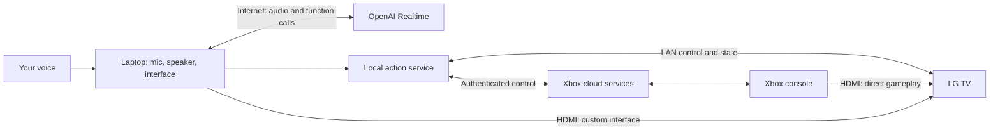

# A personal AI interface for an LG TV and Xbox Series X

Researched September 27, 2026. This is the original feasibility study, not the current implementation plan or a hardware test. Device identity was unknown at research time and is now confirmed in [room facts](room.md). Native playback, Xbox control, overlay coexistence and automatic ambient entry now have evidence in [implementation status](implementation-status.md). Follow [the roadmap](roadmap.md) for current priorities; proposals and uncertainty below preserve the original research context.

**Original recommendation (the selected controller architecture):** use an external voice/controller service with LG, Xbox and YouTube adapters. Start with two concrete journeys: launch an installed Xbox game and control the room; then open native LG YouTube, select a music video, correct the song conversationally inside the running app, and return to Xbox. The follow-up research strengthens the case for YouTube Lounge as the in-app playback adapter. See [the detailed journeys and experiment gates](journeys.md). The broader customization options below remain useful for later iterations.

## Refined first demo: say it, then YouTube plays it

Desired experience: from the home screen, say “Play [song] by [artist], the music video.” The assistant infers YouTube, searches, selects the intended upload, and starts playback without requiring manual search navigation.

Proposed flow: external microphone → voice intent → YouTube search → ranked real video ID → native YouTube playback on LG. Set YouTube as the preference for music-video requests. Prefer the actual artist/channel and requested version; use one short clarification only when there are genuinely competing matches. Follow-up “Actually, the live version” should reuse the song/artist context and resolve a new video. These are proposed behaviors, not already implemented features.

YouTube's official Data API `search.list` accepts a text query and returns matching video IDs and metadata. Use actual returned results rather than letting the model invent a URL. Public search uses a project API key and is separate from controlling playback or reproducing a user's personalized YouTube recommendations. Current documentation lists a default 100 search calls per day, sufficient to explore a small prototype but something to check during repeated testing. [Search API](https://developers.google.com/youtube/v3/docs/search/list), [API requests and credentials](https://developers.google.com/youtube/v3/sample_requests), [current quota](https://developers.google.com/youtube/v3/getting-started)

For playback, Connect SDK's webOS implementation contains `launchYouTube(videoId, startTime)` using the paired TV launcher and YouTube content parameters. This is implementation evidence for direct video launch without root; it is not a present-day guarantee for every LG/YouTube release. The meaningful result is the requested video actually playing, not merely a successful launcher response. [Connect SDK source](https://github.com/ConnectSDK/Connect-SDK-Android-Core/blob/master/src/com/connectsdk/service/WebOSTVService.java)

For ongoing playback and conversational corrections, evaluate the unofficial YouTube Lounge protocol alongside the native app launcher. PyYtLounge implements video selection within an already-running receiver, plus playback controls and events. Receiver startup and pairing still need testing. Google's supported consumer casting/TV-code experience confirms that remote video selection is a normal YouTube capability, but does not make the community Lounge API a supported public automation API. [PyYtLounge documentation](https://pyytlounge.readthedocs.io/en/latest/), [current implementation](https://github.com/FabioGNR/pyytlounge/blob/master/src/pyytlounge/wrapper.py), [YouTube casting and linking](https://support.google.com/youtube/answer/7640706?hl=en)

Latency goal: immediate feedback after the request and playback within a few seconds when the receiver is ready. This is a product target, not measured performance. Keep the voice/control connection established and reuse successfully resolved choices where appropriate. Cold app startup, account/profile prompts, ads, and buffering can dominate the wait. Measure from the end of speech to the requested video's first frame/audio; count advertising or prompts separately rather than reporting app launch as playback.

First hardware test: from LG Home, request one known video ID; then repeat while YouTube is already open, while another video is playing, and after leaving YouTube for Xbox. Confirm unattended start and record timings. Only then connect live search and voice. Test several previously untried song requests as well as favorites. The baseline requires no custom TV UI or Xbox integration; keep the microphone external for the webOS restrictions documented below.

The first implementation decision is which playback adapter works reliably on this exact TV. If native handoff proves unreliable, an external-computer YouTube player remains an alternative, with browser playback restrictions to validate. A capture-card or persistent-overlay project contributes nothing essential to this initial use case.

## Broader customization recommendation

For a later custom-interface demo, build a small external voice assistant that controls the real TV and console, with a custom full-screen interface shown on the TV. Keep Xbox gameplay on its direct HDMI connection. Once that works, decide whether installing the visual frontend on webOS adds enough value. Treat a persistent overlay over gameplay as a separate experiment.

That can deliver the effect you described: your screen becomes a personal, conversational interface; you choose an activity, correct yourself naturally, and the actual hardware responds. Replacing the operating system contributes little to that first demonstration.

## The conversation you remembered

The local X archive contains a high-confidence match: Murat Ayfer (@mayfer), September 9, 18 days before this research. His [GoatRemote announcement](https://x.com/mayfer/status/2097499753856782434) showed a computer-based TV experience, including Omarchy on Raspberry Pi. [Your reply](https://x.com/transitive_bs/status/2097521290517401877) asked whether it would allow that sort of control of friends' smart TVs and included an image. [His response](https://x.com/mayfer/status/2097536240472170800) described an always-listening keyword mode. The attachment's existence is verified, but I could not visually confirm the Tony Stark image because the local media cache is empty.

The current [GoatRemote website](https://goatremote.com/) describes a Mac/Linux application controlled by a Siri Remote, phone, or other microphone. It provides voice commands, transcription, and computer interaction, and advertises local model operation. Its relevance is the external-computer approach. It is not evidence that arbitrary LG firmware can be modified, nor a ready-made LG/Xbox Realtime integration. Trying its existing experience could be useful before designing your own.

## What is feasible

| Desired effect | Assessment | Main boundary |
| --- | --- | --- |
| Speak naturally to adjust TV volume, mute, and switch inputs | Strong first-demo candidate | Pairing and exact-model validation |
| Launch a few installed Xbox games by name | Documented integration path | Microsoft account linking, remote features, internet |
| Display your own full-screen home/assistant interface | Strong candidate | Computer HDMI is easiest; webOS app is another route |
| Keep voice working during gameplay | Strong candidate | Run microphone, speaker, and session externally |
| Display a brief notification over the TV picture | Existing LG integration feature | Native toast appearance and behavior; test during HDMI |
| Display arbitrary translucent UI over direct Xbox HDMI | Experimental | No ordinary documented overlay API; homebrew evidence is model-specific |
| Ask questions about what is currently on screen | Separate, plausible extension | Must acquire real pixels; control APIs do not provide them |
| Replace LG firmware or the Xbox OS | Poor fit for this goal | Much greater hardware/platform scope |

The LG integration documents webOS 2.0+ support, source selection, volume, playback, notifications, and power-off. Wake requires an additional path such as Wake-on-LAN or CEC, with network/settings constraints. These are existing device-control capabilities, not capabilities created by the LLM. [Home Assistant LG integration](https://www.home-assistant.io/integrations/webostv/)

Home Assistant documents Series X/S support, launching installed applications, returning Home, remote buttons/text, and power. Setup requires an adult account and Remote features. It uses Xbox Network; waking depends on Sleep configuration. Treat this as a community integration with documented capabilities, not a Microsoft automation guarantee. [Home Assistant Xbox integration](https://www.home-assistant.io/integrations/xbox/)

## Approaches and trade-offs

### 1. External assistant and a custom screen — best first build

A laptop runs the voice session, a small local control service, and a full-screen web interface. Its HDMI output occupies one TV input; Xbox remains on another. The assistant changes the TV's selected input when you choose to play, and can bring its own interface back later.

Advantages: fast iteration, familiar web development, easy debugging, no firmware changes, and the main gameplay path stays intact. You can initially omit the large interface and prove control with voice plus native TV notifications.

Trade-offs: an external computer must be running; the custom interface disappears when Xbox HDMI is selected. This is genuine control of the hardware, with an external user interface. It does not make your interface the TV's native system launcher.

**Audio detail:** use the laptop's speakers, a separate speaker, or a phone for assistant speech. Sending speech only over the laptop's HDMI would make it disappear when the TV switches to Xbox. The same principle applies to the microphone and voice session: their lifetime must not depend on which screen is visible.

If you already use Home Assistant, reuse it for both devices. If not, a tiny direct LG adapter may be the quickest TV-only experiment: `aiowebostv` provides paired control and subscribed state. For Xbox, weigh Home Assistant's existing account-linking flow against maintaining authentication yourself. The current HA release uses `python-xbox`, whose author describes a community API client; its provider implements launch/status/power operations. [aiowebostv](https://github.com/home-assistant-libs/aiowebostv), [HA release manifest](https://raw.githubusercontent.com/home-assistant/core/2026.9.3/homeassistant/components/xbox/manifest.json), [python-xbox](https://github.com/tr4nt0r/python-xbox), [provider reference](https://tr4nt0r.github.io/python-xbox/reference/smartglass/)

### 2. Install your own webOS frontend — strongest “my software on my TV” version

Package the same visual frontend as an LG web app and sideload it through LG Developer Mode. Keep voice and orchestration on the companion computer/phone. This gives you a real app running on the television while retaining LG's existing hardware support.

Allow for changes to the frontend for the TV's browser engine and platform-specific APIs; desktop-browser code is not guaranteed to run unchanged. [LG web-engine specifications](https://webostv.developer.lge.com/develop/specifications/web-api-and-web-engine)

The key limits are developer-session maintenance, app lifecycle, and platform APIs. LG says development apps are removed when Developer Mode becomes disabled, including after a reboot following session expiry. Extend the session before it expires. Installing an app does not make it the default home screen or grant system privileges. Normal app lifecycle hides/suspends the previous app when another launches, so the app is not a dependable overlay or background voice host. [LG Developer Mode](https://webostv.developer.lge.com/develop/getting-started/developer-mode-app), [LG app lifecycle](https://webostv.developer.lge.com/develop/getting-started/app-lifecycle)

Do not plan to run the complete browser Realtime client on a stock TV. In August 2025 LG support stated WebRTC is available only to contracted partner apps. In a separate exchange, LG explained that ordinary apps cannot obtain connected microphone/camera streams; Magic Remote speech is processed into text input. That is different from providing raw microphone audio to your own speech API. [LG WebRTC clarification](https://forum.webostv.developer.lge.com/t/webrtc-getusermedia-webos-24/27587), [LG microphone clarification](https://forum.webostv.developer.lge.com/t/focus-restoration-after-mic-permissions/27445)

My judgment: choose this after the external prototype if the video needs to demonstrate software installed on the TV itself. A full-screen custom app plus real control already makes that point.

### 3. Homebrew customization and native overlays — promising, conditional

LG's official developer forum said in December 2022 that no API was provided for third-party overlays over HDMI. That is a statement about the supported app platform, not proof that every firmware version makes overlays impossible. [LG overlay discussion](https://forum.webostv.developer.lge.com/t/is-there-an-api-like-in-android-tv-to-overlay-ui-element-on-the-screen/1418)

A useful counterexample is the recent `webos-ssh-client` project: its author reports a terminal overlay above HDMI and other apps on an LG G4 with webOS 25. Its installation documentation says transparent overlay mode uses Homebrew/rooted-webOS window metadata; an ordinary Developer Mode install may behave as a normal foreground app. The manifest uses `defaultWindowType: "overlay"`. This is an author-reported prototype and source-code lead, not independently validated compatibility with your TV. [Project](https://github.com/sh00bx/webos-ssh-client), [installation caveat](https://github.com/sh00bx/webos-ssh-client/blob/main/docs/INSTALL.md), [manifest](https://github.com/sh00bx/webos-ssh-client/blob/main/appinfo.json)

My judgment: if a live HUD is essential, first identify your model/firmware and time-box a minimal transparent-window experiment. Do not build a polished UI until that window actually works over your Xbox input. Rooting is a later decision based on compatibility and recovery options; it is not necessary for the basic voice-control demonstration.

Root compatibility cannot be inferred from “LG” or model year. RootMyTV's original chains are largely patched on firmware released since mid-2022. The newer faultmanager method's author reports extensive patching as of August 2025. Use the exact model, software version, and webOS version with the compatibility checker; there is no compatibility verdict for your set yet. [RootMyTV status](https://github.com/RootMyTV/RootMyTV.github.io), [faultmanager patch status](https://github.com/throwaway96/faultmanager-autoroot#patch-status), [compatibility checker](https://cani.rootmy.tv/)

### 4. Capture or stream gameplay and composite an overlay — flexible visual fallback

A capture card can supply gameplay video to the computer while forwarding the original signal to the TV. OBS can layer a browser interface over that captured video. But **the capture card's HDMI passthrough does not contain the computer's overlay**. To see the composite on the physical television, the television must show the computer's output. That adds a capture/render/display path and may change latency, resolution, HDR, or VRR behavior. This is a signal-path inference, not a measured latency claim. [Elgato Series X/S setup](https://help.elgato.com/hc/en-us/articles/5328765766541-Elgato-Game-Capture-HD60-X-Xbox-Series-X-S-Setup), [OBS browser sources](https://obsproject.com/kb/browser-source), [OBS projector output](https://obsproject.com/kb/power-of-projectors)

Xbox Remote Play is another possible pixel source without capture hardware. It streams games from your own console, but Microsoft's consumer feature is not a documented frame-export or embedding API. Capturing an approved browser window would need a practical test. HDCP-protected media should not be assumed capturable. [Xbox Remote Play](https://www.xbox.com/en-US/consoles/remote-play), [Elgato capture restrictions](https://help.elgato.com/hc/en-us/articles/5328765766541-Elgato-Game-Capture-HD60-X-Xbox-Series-X-S-Setup)

For a video-only composite, label it as such. Filming the physical TV responding to real commands is a simpler way to establish that the demonstration works.

## Suggested architecture

The diagram shows two selectable picture sources, not two simultaneous images. An optional webOS app can replace the computer's HDMI frontend without moving voice onto the TV.

OpenAI's Realtime API provides speech-to-speech sessions and function calls; its browser documentation recommends WebRTC. Your application executes functions and returns their results. A local function bridge is enough: OpenAI does not need a public endpoint directly into your television. Keep the standard API key in the local server and use the documented browser session handshake or ephemeral client credentials. [Realtime getting started](https://developers.openai.com/api/docs/guides/realtime), [WebRTC](https://developers.openai.com/api/docs/guides/voice-webrtc), [function tools](https://developers.openai.com/api/docs/guides/realtime-mcp)

Suggested first tools are `get_room_state`, `set_tv_volume`, `select_tv_input`, `launch_known_game`, and `show_home_screen`. These are proposed application functions, not vendor API names. Resolve friendly names to known device and game IDs in code. Home Assistant exposes authenticated JSON service calls for adapters. [HA REST API](https://developers.home-assistant.io/docs/api/rest/)

Use ordinary code to validate arguments, order dependent operations, and report errors. Send the model observed state rather than relying on its memory of previous commands. Show “starting” after command acceptance, then “ready” after observation; an accepted request and completed action are different facts.

During the demo, keep the laptop awake, test input switching alongside HDMI-CEC, and verify how volume commands behave with any soundbar or receiver. Prepare the chosen installed game and signed-in console profile. These are small practical checks that can matter more than another round of prompt tuning.

There is also a current GPT-Live architecture that separates full-duplex speech from a reasoning backend. It is worth evaluating if continuous interruption while work runs is central. For this small tool set, the requested Realtime API is a direct starting point. Home Assistant's built-in OpenAI conversation/STT/TTS configuration is another convenient option, but should not be assumed to provide the same custom Realtime interaction. [OpenAI voice architecture comparison](https://developers.openai.com/api/docs/guides/voice-agents), [HA OpenAI integration](https://www.home-assistant.io/integrations/openai_conversation/)

## A demo worth making

My suggested 60–90 second sequence:

1. Start with your clean custom home screen. Say: “I have twenty minutes. Give me two relaxed options from my games.” Use a small curated catalog of games you actually have, with honest metadata.
2. The screen shows two choices. Say: “The second one. Keep it quiet.” The assistant resolves the reference, selects the known game, adjusts TV volume, and switches to the Xbox input.
3. Show the real game launching. Keep the assistant voice audible through its independent output.
4. Say: “A little quieter.” The assistant uses current volume and changes it without requiring device names or an exact command phrase.
5. Say: “Bring my home screen back.” The interface returns. Do not claim that switching the display also pauses or saves the game.

The distinguishing feature is the coherent conversation across your preferences, interface, and devices. A demonstration consisting only of “turn on the TV” would communicate much less of what you want to show.

For reliability, start with push-to-talk on the phone or a nearby microphone. Add a wake word after the interaction works with TV sound playing. Voice activity detection detects speaking/turn boundaries; it does not by itself solve wake words, room echo, or distinguishing movie dialogue from the user. [OpenAI VAD documentation](https://developers.openai.com/api/docs/guides/realtime-vad)

## Boundaries that prevent wasted work

- **Xbox launch is not game-world control.** Current HA source activates product IDs and exposes coarse app/media state. It does not establish APIs for saves, Quick Resume, arbitrary in-game settings, or universally pausing games. [Release media-player source](https://raw.githubusercontent.com/home-assistant/core/2026.9.3/homeassistant/components/xbox/media_player.py)
- **A game's cover image is not a screenshot.** The same source uses promotional/tile/box art. Screen-aware answers need actual image capture. Realtime accepts image input, but that does not give it access to TV pixels. [Xbox source](https://raw.githubusercontent.com/home-assistant/core/2026.9.3/homeassistant/components/xbox/media_player.py), [Realtime image input](https://developers.openai.com/api/docs/guides/realtime-conversations)
- **Xbox Developer Mode is a detour.** Microsoft's documentation says it cannot run retail games/apps; returning to Retail Mode requires a restart. It is useful for a standalone experiment, not a companion UI coexisting with normal gameplay. [Microsoft Developer Mode](https://learn.microsoft.com/en-us/previous-versions/windows/uwp/xbox-apps/devkit-activation)
- **Old SmartGlass tutorials can mislead.** The historical local-protocol library was archived in 2021 and targets Xbox One. Current HA uses a different community client and Xbox cloud services. [Archived SmartGlass Core](https://github.com/OpenXbox/xbox-smartglass-core-python), [HA current release dependency](https://raw.githubusercontent.com/home-assistant/core/2026.9.3/homeassistant/components/xbox/manifest.json)
- **HDMI-CEC is supplemental.** Microsoft documents useful power/volume interactions, but this does not provide an application launcher, custom renderer, or screen reader. [Xbox CEC announcement](https://news.xbox.com/en-us/2022/10/19/xbox-october-update-rolls-out-today/)
- **Ownership and offline operation are different.** You would own the interface, local code, and device mappings. OpenAI speech and the recommended Xbox integration would still use cloud services. A local voice stack is a separate option if offline use later becomes part of the goal.

## Effort, cost, and the first decision

These are planning estimates for an experienced developer with AI assistance, not measured delivery commitments:

| Milestone | Planning range | Assumption |
| --- | --- | --- |
| Prove TV pairing, volume, input switching, and one notification | 30–90 minutes | Compatible webOS model and reachable LAN |
| Prove Xbox linking, waking, and one game launch | 30–90 minutes | Working OAuth and remote configuration |
| Rough voice-controlled version | Several hours | Device commands already verified |
| Polished external-screen demo | 1–3 focused days | One room, a handful of commands, no live gameplay overlay |
| Native webOS frontend | Another 1–3 focused days | Developer Mode works; modest frontend |
| Rooted overlay/firmware work | Unbounded until compatibility is checked | Exact model and firmware required |

Use your existing laptop and microphone first. A compatible HDMI connection may be the only extra hardware needed for the full-screen version; no capture card is required for control alone.

As a cost scale, the currently documented `gpt-realtime-2.1` audio rates are $32/million input tokens and $64/million output tokens. With documented audio tokenization, one minute of fresh user audio is about $0.0192 and one minute of generated speech about $0.0768. Five minutes of each is roughly $0.48 for those new audio tokens alone. This is **not** a ten-minute-session quote: repeated context, text/tool tokens, optional transcription/images, and reasoning can add charges. Use actual session usage when budgeting. [Model rates](https://developers.openai.com/api/docs/models/gpt-realtime-2.1), [Realtime cost mechanics](https://developers.openai.com/api/docs/guides/voice-latency-cost?voice-api=realtime)

Before choosing a build, collect the TV's full model number, webOS and software versions; note available HDMI ports, soundbar/receiver routing, and whether a computer can stay nearby. Then run the two short device-control checks above. If Xbox authentication consumes the time box, keep the first demo focused on TV control and switching to an already-running Xbox; do not imply game launch succeeded until it does.

**Decision rule:** choose the external interface for the fastest convincing video; add a webOS app when running your own code on the TV is part of the story; investigate homebrew only when a persistent native overlay is essential. Full operating-system replacement is outside the useful scope of this proof of concept.
