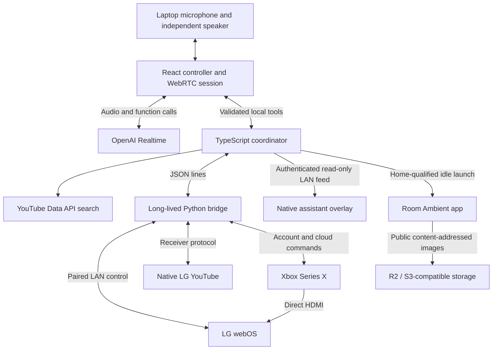

# Implementation plan and architecture

Updated September 30, 2026. This document describes the implemented architecture and engineering constraints. The [roadmap](roadmap.md) owns current priorities: finish the visual experience, prove complete journeys and recovery, film the real devices, then release a reproducible open-source technical preview. It supersedes the original September 27 scaffolding plan; completed preparation work is not a new prerequisite.

## Product contract

Deliver a personal interface for the owner's LG webOS TV and Xbox Series X that remains useful after filming, then make it replicable by other technical owners. Preserve native LG YouTube, Xbox Retail Mode and direct HDMI gameplay. Keep voice and orchestration on the laptop for the first release. A separate TV overlay provides live visual feedback; Room Ambient supplies artwork and automatic entry after LG Home idles.

[User journeys](journeys.md) define the experience. [Implementation status](implementation-status.md) and [ambient evidence](ambient-screensaver.md#evidence-so-far) distinguish code from observed behavior. The owner's exact model, firmware and setup are recorded in [room facts](room.md); broader compatibility is not established.

## Implemented architecture

Use modern TypeScript/ESM, pnpm and the shared Oxlint/Oxfmt configuration. React/Vite supplies the operator UI. The Node coordinator owns validation, source sequencing, cancellation, search context and traces. One long-lived Python bridge keeps paired LG, YouTube and Xbox clients alive over JSON lines; Python is locked with uv. Prefer ky, zod and p-map for HTTP, boundary validation and bounded independent work.

The overlay bundles React, Thinking Orbs Canvas 2D and Voice Glow Canvas/SVG/CSS locally. Its lab and TV app share the renderer; real voice amplitude and tool/session events already feed it. Final appearance and physical animation performance are M1 work. [Visual lab](visual-lab.md), [graphics limits](overlay-graphics.md).

Room Ambient is a separate opaque app with cover framing, gentle focal-point motion, shuffled image rounds, bounded prefetch, persistent titles and remote controls. The laptop watcher uses observed LG `Screen Saver` state after Home; the optional remembered native guard keeps the foreground slideshow visible. These are distinct responsibilities, not system-wide screensaver registration. [Ambient architecture and acceptance](ambient-screensaver.md).

## State and device boundaries

- [Contracts](../src/contracts.ts) define configuration, model arguments and state timestamps. [Agent tools](agent-tools.md) is the human-readable tool inventory; keep it aligned with actual definitions rather than maintaining another list here.
- [Coordinator](../src/coordinator.ts) uses `accepted`, `observed`, `failed` and `superseded` outcomes. A source change supersedes older media work and shares the source lane; volume can run independently. Newer intent must win even after an older vendor command has already been delivered.
- Keep search context separate from confirmed playback. Only backend-resolved candidate IDs, installed game aliases and discovered app/input IDs reach devices. A failed or late search must not corrupt the current choice. No generic remote-button agent is needed for the target journeys.
- The warm YouTube path selects within a live receiver. The cold path launches the discovered native app, establishes receiver readiness, selects the video and awaits matching fresh evidence. Wrong receiver, stale video or wrong foreground cannot pass observation. The existing delayed receiver observations remain a reliability task; do not turn accepted into observed to hide them.
- Xbox may report a completed launch operation without a usable active-title field. Preserve that distinction; physical game activation is its own evidence. Switching HDMI does not pause or save a game.
- [Automatic ambient](../src/ambient-auto.ts) is Home-qualified, opt-in and cancelled by explicit activity; its fresh launch check shares device sequencing. Other apps, unknown/off states and disconnected/stale observations cannot cause a catch-up launch or a wake. Detailed cooldown and recovery acceptance live in the ambient document.

## Voice and presentation

The browser sends an SDP offer to the local server; the server creates the Realtime call with a server-side API key and returns the answer. The current model is configurable in local environment. Keep the session established through source changes and use an independent laptop audio path. [Voice implementation](../web/voice.ts), [session setup](../src/realtime.ts).

Complete function calls execute through the same coordinator as manual controls and return their original call IDs. Voice interruption also cancels pending device work. Session/sequence guards reject stale voice and amplitude updates. The TV receives bounded amplitudes, not raw audio; it does not require another microphone or voice provider.

The assistant should act, acknowledge briefly when useful, and recede. Display truthful listening/thinking/speaking/completion states; show one useful recovery action when something fails. Developer diagnostics retain caveats, timestamps and uncertainty. Concision does not authorize claiming a failed or unobserved action succeeded.

Push-to-talk is the reliable filming baseline. Open mic is optional after testing real room acoustics. Magic Remote microphone capture, wake words and a TV-only voice runtime are later experiments.

## Local configuration and security boundaries

- The control API binds to loopback with host/origin checks. The TV uses a separate authenticated, read-only LAN display feed; do not expose the full control API to the LAN for convenience.
- API keys, pairings and account refresh tokens live in ignored `.env` / `.local` with owner-only permissions. Credentials stay out of TV packages, browser bundles, model arguments and traces.
- Xbox uses a short-lived loopback callback and state validation. Suppress authorization-code/authenticated-URL logging. Public preview must validate client-registration and dependency-distribution assumptions before publication.
- Keep explicit Live/Simulation status. Missing hardware never silently substitutes a mock. Simulation is useful for development, not hardware acceptance.
- The image catalog ships metadata and public URLs; cloud write credentials are uploader-only. Retain bounded cache/retry behavior on the TV. Public release needs portable catalog configuration and rights-cleared example assets.
- Use existing saved settings through restarts. A real credential revocation calls for a clear reconnect step, not a hidden re-pair or an invented healthy state.

## Development and validation

The checked-in package scripts are authoritative. `pnpm dev` builds TV assets and starts the watched controller through Portless at `https://smart-tv-for-real-tho.localhost` (use the printed URL for a custom proxy port/worktree). `PORTLESS_URL` supplies the exact allowed proxy origin and `PORT` the loopback backend port; Vite HMR shares that HTTP server. The separate token-protected TV LAN feed and Xbox loopback OAuth callback keep their existing addresses. Backend TypeScript / `bridge/main.py` changes restart it in the user's working network-enabled Terminal. `pnpm dev:restart` requests a restart of that existing watcher. Native visual changes require rebuilding and installing the relevant TV package; a browser preview is not a TV deployment. `pnpm dev:stable` avoids code-triggered restarts while filming.

Use focused regression tests for source races, stale/wrong receiver events, voice interruption, reconnect failure, idle/power exclusions and bounded image recovery. Run the repository checks and appropriate builds for changed code. [Hardware runbook](runbook.md) supplies physical timing/recovery probes; [demo session](demo-session.md) assembles them into one batch.

Record software acceptance separately from first visible/audible effect. Report a small-run median and worst observed delay without implying a statistical guarantee. Visible acknowledgement within roughly one second and warm media changes around three to five seconds remain product targets to measure, not current guarantees. Native launch/loading and buffering may be slower.

## Current boundaries

The selected route needs neither replacing webOS nor switching Xbox into Developer Mode. The native transparent baseline has worked over both YouTube and Xbox on this TV; source changes can dismiss it, and the existing restoration path requires its final animated-build checks. The accepted brief launch flash and graphics frame pacing are separate issues. No external video capture/compositing hardware is required.

Keep the existing adapter and renderer architecture for the next milestones. TypeSafe ranking, service aggregators, a generalized plugin framework, arbitrary-app navigation and root/system changes are not prerequisites. Broader hosting and store distribution are assessed after the technical-preview path; see [distribution](distribution.md).
