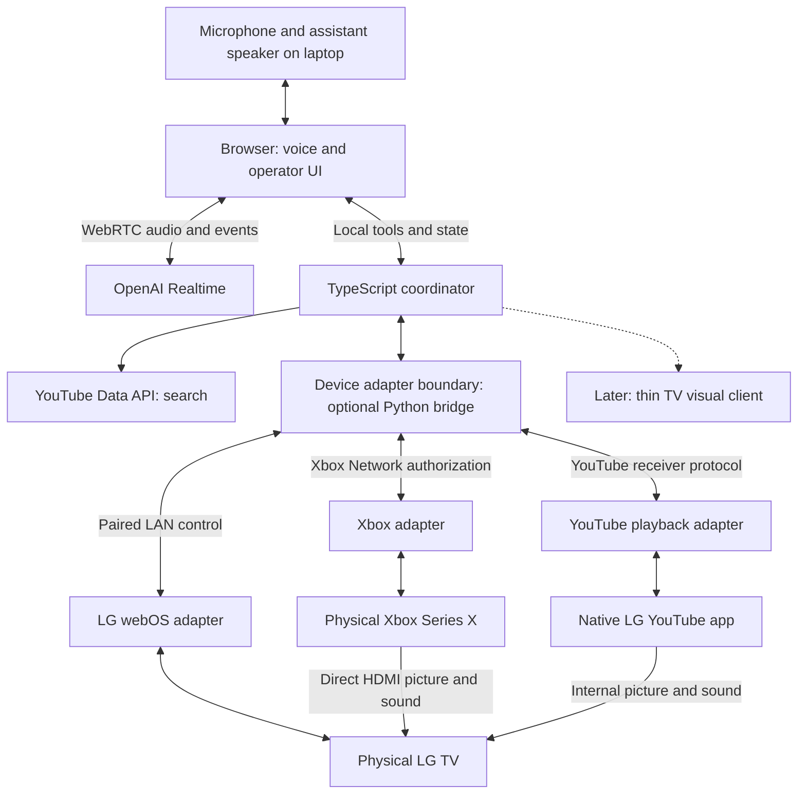

# LG + Xbox voice-control spike: implementation plan

Prepared September 27, 2026. **Implementation began September 28; current evidence and remaining gates are in [implementation status](implementation-status.md).** The architecture and gates below remain the original scope. Historical preparation context follows. The TypeScript scaffold and portable documentation are in place. Feature implementation, device connections, account authorization and live API testing are future work. This document provides context for that later implementation session.

## 1. Purpose and the result that counts

Build a compelling, filmable demonstration of personal software controlling the user's actual LG webOS television and Xbox Series X. Natural conversation should cross device boundaries and correct media choices inside a running native app. Preserve the existing TV software, Xbox software and direct gameplay connection.

The laptop can remain the controller in the live version. “Integrated with the real devices” means the actual TV switches sources, the actual console opens a game, and native LG YouTube plays the requested videos. Moving the entire assistant onto the television is not required to achieve that result.

The first deliverable is a working local application plus a reproducible live demonstration. A laptop simulation helps development but does not satisfy the live-device milestone. The second visual milestone is a real on-TV assistant layer, starting with a small compatibility test before investing in animation. Its feasibility remains unresolved.

Known context: a reportedly recent 86-inch LG, bought less than a year ago; Xbox Series X; current Mac assumed to be the host; existing OpenAI API access; willingness to enable relevant settings. Purchase age and screen size are enough to design the controller but do not identify firmware or establish overlay compatibility.

Prior evidence and boundaries are recorded in [the feasibility study](feasibility.md) and [the concrete journeys](journeys.md). This plan selects an implementation; those documents retain the broader alternatives.

## 2. Demo contract

### Journey A: game and room control

Starting state: LG Home, TV awake, Xbox on and signed in, one chosen game installed and updated.

1. “Open [game] on Xbox and set the volume to 15.” Select the Xbox input, activate the installed title, and set the actual room volume.
2. “A little quieter.” Reduce volume by a configured small amount while keeping the picture.
3. “Go to Xbox Home.” Return to the console dashboard.
4. “Back to TV Home.” Return to LG Home.

Launching a title means activation, not loading a save or proving gameplay readiness. Input switching does not promise that a game pauses. Use explicit destinations for the two different home screens.

### Journey B: native YouTube and conversational correction

Starting state: Xbox HDMI visible; repeat from LG Home too.

1. “Play [song] by [artist], the music video.” Search real results, open native LG YouTube, and play the selected video.
2. “No, play [another song].” Retain the artist when appropriate and replace the current video within the running YouTube app.
3. “Actually, the live version.” Refine the selection using the previous request; ask one concise question if necessary.
4. “Pause.” Then “Continue.”
5. “Back to Xbox.” Pause YouTube explicitly, select Xbox HDMI and reveal the console's current state.

Use known video IDs for diagnostics only. The completed demo must include genuine search and at least two requests that were not preselected during implementation. Relative seeking is a small optional extension; queue editing is outside the first scope.

### Completion criteria

- Both journeys operate the physical devices, including native LG YouTube.
- A song correction changes the running receiver without manual search navigation.
- P3 passes three consecutive diagnostic hardware transitions using known videos, including a cold YouTube start. P5 then passes two complete voice-and-search rehearsals without developer intervention.
- Restarting the controller reconnects with saved pairings/authorization, or clearly identifies a revoked credential requiring reconnection.
- One interrupted request cannot finish later and override a newer media/source choice.
- The demo produces an understandable failure when a receiver is unavailable; command acceptance is never presented as observed playback.
- A short runbook, measured timing log and recording storyboard accompany the app.

## 3. Architecture direction

The committed foundation is **TypeScript, ESM, pnpm, Oxlint and Oxfmt**, using the owner's shared configuration. A small React/Vite browser UI and a Node.js TypeScript coordinator are the proposed application direction; the web/server framework is not installed or fixed by this preparation task. Prefer ky for HTTP, zod for boundary validation and p-map for bounded independent work.

The researched device clients below are Python libraries. Before implementing the adapters, compare a minimal long-lived Python bridge against suitable TypeScript clients; do not assume equivalent TypeScript coverage exists. Reusing those proven libraries behind a narrow local interface may be faster than porting protocols. If selected, keep pairing, receiver sessions and reconnect logic in that bridge while TypeScript owns application orchestration. Add the Python environment only then, resolve compatible versions and lock them. The original Python/FastAPI service remains an alternative, not the committed application stack.



### Researched integration candidates

| Responsibility | Choice | Implementation boundary |
| --- | --- | --- |
| LG input, app launch, volume, Home, state | `aiowebostv` | Pair locally; discover actual app/input IDs; subscribe to state. |
| Xbox title launch and dashboard | `python-xbox` (`pythonxbox` import) | Browser authorization, installed-product catalog, cloud control and state. |
| YouTube video and playback | `pyytlounge` | Pair the native LG receiver; replace video, pause/resume and read events. |
| Public video discovery | YouTube Data API v3 | Server-side API key; real video candidates and metadata. |
| Voice and contextual selection | OpenAI Realtime | Browser audio; validated local function execution. |
| Visual feedback | Same event model, separate display view | Laptop first; native TV rendering only after its gate passes. |

`aiowebostv` supplies pairing and subscribed state. The YouTube wrapper implements immediate video selection within the connected receiver. These are community integrations whose behavior must be validated on this TV. [LG library](https://github.com/home-assistant-libs/aiowebostv), [YouTube implementation](https://github.com/FabioGNR/pyytlounge/blob/master/src/pyytlounge/wrapper.py)

If Home Assistant already controls these devices, reuse its working integrations behind the same adapter interfaces. Otherwise start directly, without deploying Home Assistant solely for this spike. For Xbox, authenticate before building console-specific polish. The current library scripts provide a public desktop-client browser OAuth route; whether it is accepted for this account is an early runtime check. Own-app registration is a fallback, not an initial signup requirement. [Xbox client defaults](https://raw.githubusercontent.com/tr4nt0r/python-xbox/main/src/pythonxbox/scripts/__init__.py), [browser authentication implementation](https://raw.githubusercontent.com/tr4nt0r/python-xbox/main/src/pythonxbox/scripts/authenticate.py)

### Realtime connection

Use the documented Realtime WebRTC unified connection: the browser sends its SDP offer to our local service, which creates the session at `/v1/realtime/calls` using the server-side OpenAI key and returns the answer. Keep the session established during the demonstration. Start with the current guide's `gpt-realtime-2.1` model, configurable and checked against account access at setup. This plan uses Realtime, without introducing a separate voice architecture. [Official WebRTC guide](https://developers.openai.com/api/docs/guides/voice-webrtc)

The browser forwards complete function calls to the local service. Return a result tied to the original call ID; then allow the model to respond. Implement both push-to-talk for initial testing and an open-mic session for rehearsal if room audio permits it. Realtime speech interruption does not itself cancel device operations: the coordinator handles that separately. [Function results and interruption](https://developers.openai.com/api/docs/guides/realtime-conversations)

Keep the standard OpenAI and YouTube keys in backend configuration. Xbox login occurs in Microsoft's browser flow; use a short-lived loopback callback with state validation and suppress authorization-code logs. Store pairings and refresh tokens in ignored local storage, never in frontend bundles or model arguments. Initially bind controls to localhost. A later TV visual client receives a narrowly exposed, authenticated LAN event feed rather than the complete control API.

### Optional services deliberately deferred

TypeSafe can be evaluated for candidate ranking if real search tests reveal a persistent selection problem. It is not required to connect the devices, and the initial implementation needs no TypeSafe key. The tool aggregator mentioned as “Treg Two” is not identified; no assumption about its name or capability is needed. Keep the narrow adapter interface extensible enough to replace a search provider later, without creating a plugin framework now.

## 4. Exactly what the user needs to provide or do

Nothing below blocks completing this plan. Most code scaffolding and local voice/UI work can begin before the model number arrives. Hardware tests require access to the room.

| Item | What is needed | When |
| --- | --- | --- |
| LG identity | Full model number, webOS version and installed software/firmware version. Serial number unnecessary. | Before model-specific troubleshooting and native-overlay work; useful at first pairing. |
| Input and sound | Xbox HDMI port/name; TV speakers vs soundbar/receiver, with its model/connection if external. | Before live source and volume tests. |
| Host | Confirm this Mac, or name the other laptop/OS. Keep it on the same reachable home LAN as LG. | Before live device tests. |
| Existing automation | Whether Home Assistant already exists and already controls either device; “none” is fine. | Before choosing direct vs existing adapters. |
| TV network access | TV IP from network settings/router, or allow discovery during setup. TV on; accept one pairing prompt. | First LG session. |
| Native YouTube | App manually works; select the desired profile and clear first-run prompts. Supply its numeric pairing code through the local form. | First playback session. |
| Xbox | Associated Microsoft account browser sign-in, Remote features enabled, console initially on. Pick one installed, updated game. | First Xbox session. |
| OpenAI | Existing project API key available locally and usable API balance/access. Do not paste the key into chat. | When adding voice. |
| YouTube search | Google Cloud project with YouTube Data API v3 enabled and a project API key entered locally. | When adding real search; not needed for known-video tests. |
| Optional content preferences | Two or three favorite songs/artists, preferred language/playback country, and whether YouTube Premium is used. | Tuning and rehearsal only; none blocks basic search or pairing. Omit an explicit region filter if unset rather than inferring it from this Mac's timezone. |
| Hands-on time | A first 30–45-minute pairing/testing slot near the TV, followed by rehearsal time. Available microphone and independent assistant speaker. | Hardware gate and filming. |

**Finding LG information:** on many recent models, pressing Mute three times displays model information; menu paths vary. Otherwise look under All Settings → Support → TV Information, or the product label. The installed software version is commonly under Support → Software Update; read the version without making an update a prerequisite. Capture both webOS and software numbers. [LG model guide](https://www.lg.com/us/support/help-library/lg-tv-how-to-identify-my-tvs-model-information--20153110698602), [software menu guide](https://www.lg.com/us/support/help-library/how-to-update-your-lg-tv-software-and-turn-on-automatic-updates--20155444905539)

**YouTube pairing and API access are separate.** In the TV app, open Settings → Add a device, or Link with TV code on versions using that label. Enter the numeric code in our local pairing UI. Our desktop controller uses an unofficial protocol implementation; Google's consumer TV-code instructions are for phone/tablet linking. Separately, in Google Cloud select/create a project, enable YouTube Data API v3, then create an API key under APIs & Services → Credentials. Public search does not require personal YouTube OAuth. [TV pairing](https://support.google.com/youtube/answer/7640706?hl=en), [API setup](https://developers.google.com/youtube/v3/getting-started), [credentials](https://developers.google.com/youtube/registering_an_application)

**Xbox settings:** Settings → Devices & connections → Remote features. The documented integration requires a non-child account. Leave the console on for the first test; Sleep is relevant when adding remote wake. Leave it in Retail Mode: Xbox Developer Mode is unnecessary for this architecture and prevents retail games/apps from running while active. [Control prerequisites](https://www.home-assistant.io/integrations/xbox/), [Microsoft mode behavior](https://learn.microsoft.com/en-us/previous-versions/windows/uwp/xbox-apps/devkit-activation)

**LG Developer Mode can wait.** It is used to install a custom TV visual app, not to pair ordinary LAN control or the YouTube receiver. The later installation requires LG's developer account/app workflow and session management. Enabling it does not establish that an overlay is available. [LG Developer Mode](https://webostv.developer.lge.com/develop/getting-started/developer-mode-app)

## 5. Small implementation surface

### Proposed future layout

```text
src/                    TypeScript application, coordinator and contracts
web/                    Proposed browser UI and WebRTC client
bridge/                 Optional Python device bridge, only if selected
scripts/                Future setup checks and hardware probes
tests/                  Future coordinator boundary and failure tests
docs/                   Implementation plan, journeys and feasibility
config.example.json     Future nonsecret device/behavior configuration
.env.example            Future credential variable names only
.local/                 Ignored credentials, discovered IDs and run logs
readme.md               Actual setup, checks and repository status
```

This is a future feature layout, not the current scaffold. During implementation, provide one documented application start command. Add a setup check that reports missing configuration, pairing and reachability without dumping secrets. Record tested library versions after the first successful real-device run.

### Model-facing functions

| Function | Responsibility |
| --- | --- |
| `get_room_state()` | Return fresh-or-stale status with observation times. |
| `start_game(game_alias)` | Resolve an installed allowed title, activate it and select Xbox HDMI. |
| `set_room_volume(level)` / `change_room_volume(delta)` | Control the actual verified audio output; validate range. |
| `show_home(target)` | Explicit `tv` or `xbox`. |
| `find_youtube_video(song, artist, version)` | Return a small set of actual candidates with opaque candidate IDs. |
| `play_youtube_video(candidate_id)` | Resolve the stored candidate, ensure native receiver readiness, select it and observe state. |
| `control_video(action)` | Explicit pause/resume; relative seek can follow. |
| `return_to_xbox()` | Pause YouTube and select the known input; do not relaunch the game automatically. |

Names above are our proposed functions, not vendor API names. Only backend-resolved candidates/product IDs reach adapters. Search can return a clear best match or a short candidate list for the voice model to select; another model service is unnecessary initially. Cache repeated queries during development, then verify unseen requests. The public API's returned metadata supports selection but does not reproduce TV personalization. [Search fields](https://developers.google.com/youtube/v3/docs/search/list)

### State, sequencing and correction

Track only current input/foreground app, hardware volume, Xbox active title, selected YouTube receiver/video/state, request context and observation timestamps. Keep state in memory, with pairings/configuration and compact JSONL traces on disk. No database or distributed queue is needed.

Use outcomes such as `accepted`, `observed`, `failed` and `superseded`. Every operation has a request ID, target and deadline. For a new song/source request, supersede the old media sequence before its next side effect. Serialize conflicting source changes; volume requests can proceed independently. A correction should not become stuck behind a long startup timeout. Refresh state before retrying an uncertain mutation; use at most a small bounded reconnect/retry path rather than blind button repetitions.

Warm YouTube path: responsive foreground receiver → select video → await fresh matching event. Cold path: launch discovered LG app → await foreground/receiver readiness → connect/refresh → select video → observe. Keep the latest request context separate from confirmed now-playing state so a failed search does not overwrite reality. Test HDMI-CEC after switching to ensure it does not undo the intended source.

Playback events are useful evidence, not proof that content is visible and audible through every prompt, ad or mute state. Development probes must record the physical result too. The library provides now-playing and playback events; freshness and foreground checks are our coordinator's responsibility. [YouTube event definitions](https://github.com/FabioGNR/pyytlounge/blob/master/src/pyytlounge/events.py)

### Operator and display UI

The operator page starts with connection status, pairing controls, manual game/video/source/volume buttons, current state and a compact event timeline. Include an explicit Simulation/Live indicator. Simulated adapters are useful for UI work but never silently substitute for unavailable hardware.

The display view uses large type, a listening indicator, interpreted artist/song or game, current destination and brief action feedback. Drive animation from real events. Keep technical logs and pairing details on the operator page. During the first live demo the TV itself shows native content; the laptop can show diagnostics without becoming the playback host.

Use the laptop microphone or a nearby USB mic and a speaker output that survives HDMI changes. Begin with push-to-talk, then test interruption with TV music playing. An open-mic demo earns its place only after the acoustic test; a Magic Remote audio integration, wake word and distant-microphone system are later work.

## 6. Ordered work packages and gates

**Preparation is separate from P0.** This repository-preparation task establishes a local Git repository, the TypeScript/pnpm toolchain, shared lint/format configuration, a lockfile, CI and portable docs. Its gate is passing tooling checks with no application behavior added. P0 through P5 remain future implementation work.

Effort ranges are engineering estimates, assuming compatible hardware and working account access. They exclude time waiting for credentials or a hands-on session; they are not commitments.

| Package | Work and concrete output | Gate | Estimated effort |
| --- | --- | --- | --- |
| P0 — executable skeleton | Local server/UI, config templates, setup check, manual controls, basic trace format. Simulated state only where useful. | App starts locally; missing credentials are explained; live status is explicit. | 1–2 hours |
| P1 — prove native YouTube | Pair receiver manually; known A → B; pause/resume; close/reopen app; restart controller and reconnect. | Actual LG plays both videos and fresh state agrees. | 1–3 hours |
| P2 — prove room controls | LG pairing and discovery; volume/input/Home; Xbox browser auth, catalog, chosen game and dashboard. | All primitives work on real devices; saved auth survives restart. | 2–4 hours |
| P3 — compose the transition | Xbox HDMI → cold-open native LG YouTube → A → B → return to Xbox. Add deadlines, freshness and cancellation. | Three complete runs including cold start; stale requests cannot steal the display. | 2–4 hours |
| P4 — speech and retrieval | Realtime, real search, artist/version context, brief clarifications, independent assistant audio. | Two unfamiliar requests plus one contextual correction succeed. | 3–6 hours |
| P5 — rehearse and film | Tune delays, acoustic behavior and visual feedback; document recovery and measured results. | Two uninterrupted rehearsals, then a real-device recording. | 2–4 hours |
| V1 — static native HUD | Exact-TV investigation; minimal transparent label over native YouTube and direct Xbox HDMI. | Coexists with picture/audio/focus, transitions and dismissal. | Initial 2–4-hour investigation |
| V2 — animated native HUD | Listening, resolved request, source transition and result graphics using the proven TV rendering path. | Graphics remain synchronized with live operations on both sources. | Estimate after V1 |

The earlier estimate was **11–23 hours for future P0–P5**, roughly a few focused build days with ready access. Reassess after selecting the TypeScript adapter or Python-bridge path; this is not an estimate for repository preparation. V1 is an additional investigation, not a promise that a firmware limitation can be solved in four hours. Run it after P3 as soon as the exact TV information is available, so its result informs filming before animation work expands.

P0 and voice/UI preparation can proceed without hardware details. P1–P3 should occur early; a polished laptop demo is not a reason to postpone the main feasibility check. If a blocker consumes a short investigation window without new evidence, record it, continue independent work and make any scope change explicit.

## 7. On-TV visuals: bounded experiment and decision

The target is a real transparent assistant layer above both native YouTube and direct Xbox HDMI. Build a minimal TV client receiving event state from the laptop, leaving voice and orchestration external. First test a dismissible static rectangle and one text label on the exact firmware.

Homebrew documentation describes overlay window metadata and notes that Home closes such windows. An example project reports an overlay on one LG G4/webOS 25 setup. That is a lead, not compatibility proof for an unidentified recent 86-inch model. Developer Mode alone may be insufficient; determine the installation/privilege requirements before proceeding. Firmware modifications are outside this first implementation plan. [Window behavior](https://www.webosbrew.org/pages/appinfojson), [example project](https://github.com/sh00bx/webos-ssh-client)

Test V1 over both sources, in the user's normal gaming display mode, with audio, remote focus, source transitions, Home and dismissal. Documented closure on Home can pass only if a tested restoration mechanism provides the desired interaction; uninterrupted persistence across Home remains a separate, unproven capability. Only then reuse/adapt the display view for animation. If V1 fails, retain the working live controls and report the HUD as unresolved. A full-screen assistant interlude or verified native toast is a smaller visual fallback with different behavior.

External capture/composition is a deliberate alternate architecture, not the automatic fallback. Xbox capture cannot contain the TV's internally generated YouTube picture, and passthrough does not include the computer's overlay. Covering both would require another YouTube playback host and testing the resulting latency/video constraints. No capture-card purchase is required to start. [Xbox capture signal path](https://help.elgato.com/hc/en-us/articles/5328765766541-Elgato-Game-Capture-HD60-X-Xbox-Series-X-S-Setup)

## 8. Verification that answers the useful questions

Write focused coordinator tests for stale-request suppression, late events from the wrong receiver, timeout/error reporting, candidate-ID validation and independent volume changes. A few fake adapters can make those cases deterministic. Avoid tests that merely restate trivial library wrappers.

Use hardware probes for what unit tests cannot establish:

- Warm and cold native YouTube playback; replacement A → B; pause/resume.
- Controller restart and saved-pairing reconnect; app closed/reopened.
- Installed game launch, separate home destinations, source switching and real audio-output volume.
- Song correction while an older search or app launch is still pending.
- Unavailable receiver and unavailable search, each producing the right failure message.
- Open-mic interruption while music is audible, if that mode is used in the recording.

Record speech end, intent ready, search complete, command accepted, fresh state observed and first requested picture/audio. Report warm/cold medians and worst observed times over a few runs; do not infer a statistical reliability guarantee. Initial design targets: visible acknowledgment within about one second and warm song changes within roughly 3–5 seconds of the utterance ending. These are goals to test, not measured capabilities. Keep ads, account prompts, buffering and game loading visible in the findings.

Fallbacks remain explicit: a manually primed YouTube app demonstrates warm control but does not pass cold launch; YouTube on Xbox is a revised host choice; fixed video IDs do not pass genuine retrieval; a laptop player does not pass native LG playback; an edited HUD does not pass V1.

## 9. Recording and handoff

Aim for a two-to-three-minute take, with actual startup time determining the length. Show the physical television, the person speaking and enough of the room to establish the devices. Start on LG Home, launch the chosen game and adjust volume, return Xbox Home, request native YouTube music, correct the song/version, pause/resume and return to Xbox. Include at least one request chosen at recording time. Keep assistant speech brief so the media and device response carry the demonstration.

If V1/V2 pass, add a short segment showing the live HUD above both sources and dismiss it. Otherwise film the real control prototype and document the visual experiment separately. A shorter edited highlight can follow the continuous proof, with the actual behavior already established.

Implementation handoff checklist:

- [ ] Runnable app and tested dependency lockfiles.
- [ ] Local setup forms for pairing/login; no credentials in deliverables.
- [ ] README with start, reconnect, reset and manual recovery steps.
- [ ] Device configuration for this exact room and one installed game.
- [ ] Recorded P1–P5 outcomes, known limitations and warm/cold timings.
- [ ] V1 result, including exact model/firmware and any unresolved privilege boundary.
- [ ] Rehearsal script and continuous real-device recording.

Suggested future implementation instruction (not authorization to start features during preparation):

> When implementation is requested, begin with P0 through P3. Use the TypeScript application foundation and select a minimal device bridge if the researched Python clients are the fastest reliable route. Keep native LG YouTube and direct Xbox HDMI, and make manual probes call the same coordinator functions that voice will later use. Proceed with scaffolding while device details are pending, then surface the smallest setup step needed for each hardware gate. Do not treat simulation as completion. After the native transition is proven, add real search and Realtime voice, then run the bounded TV-overlay experiment before substantial visual polish.
