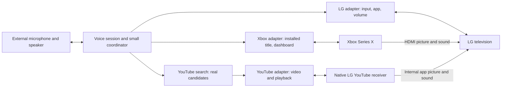

# Two journeys for a conversational LG TV and Xbox

Research checked September 27, 2026. This is an evidence-based experiment design; no commands have been tested on your TV or console. Exact LG model, firmware, webOS version and audio setup remain unknown.

Next step: [the detailed prototype implementation plan](implementation-plan.md) turns these journeys into build tasks, setup requirements and hardware acceptance gates.

**Recommendation:** build one external voice controller with three narrow integrations: LG for the visible app/input and room volume, Xbox for installed games and console navigation, and YouTube for the selected video and playback. Keep native LG YouTube and direct Xbox HDMI for the first experiment. These journeys have credible existing control paths without replacing either operating system. A persistent graphical overlay is a separate, less certain hardware experiment.

## What changed in the assessment

The strongest new finding is that YouTube has a useful in-app control path. PyYtLounge's `play_video(video_id)` sends a `setPlaylist` command to the connected YouTube receiver. It can change the video in an already-running app rather than repeatedly launching it. This is immediate video selection, not an append-to-queue operation. [Inspected implementation](https://github.com/FabioGNR/pyytlounge/blob/master/src/pyytlounge/wrapper.py)

There is also practical compatibility evidence: iSponsorBlockTV uses this library and lists both LG webOS and Xbox One/Series as working. This supports playback observation/control on those platforms, but does not certify every command, firmware combination or startup path. Its current warning about revoked pairing codes also illustrates the maintenance risk of an unofficial protocol. [Project compatibility and dependencies](https://github.com/dmunozv04/iSponsorBlockTV#compatibility)

## Journey 1: start playing, then control the room

Starting conditions: TV awake on LG Home, console signed in, one known installed game. Test waking sleeping devices after the basic sequence works.

| You say | Intended visible result | Integration and success check |
| --- | --- | --- |
| “Open [installed game] on Xbox and set the volume to 15.” | TV selects Xbox HDMI, the game starts, room volume changes. | Xbox launches the known title; LG selects the input and sets hardware volume. Check title/input/volume plus actual picture. |
| “A little quieter.” | Audible volume decreases while gameplay remains visible. | Apply a small configured change to the actual TV/soundbar output. |
| “Go to Xbox Home.” | Xbox dashboard appears. | Console navigation, without changing the TV input. |
| “Back to TV Home.” | LG's home screen appears. | LG Home command, with its own display state. |

LG's existing integration covers source selection, volume and remote commands. Xbox's integration covers installed app/game launch, Home and remote input; account linking and Remote features are required, and wake depends on power settings. Home Assistant is an optional implementation shortcut, not a requirement to build a whole home-automation system. [LG capabilities](https://www.home-assistant.io/integrations/webostv/), [Xbox capabilities and setup](https://www.home-assistant.io/integrations/xbox/)

Keep “Xbox Home” and “TV Home” distinct in the demo. A later default for “home” can follow the active device. Also distinguish a title becoming active from the game being ready to play: intro screens, updates and loading remain the game's responsibility. Leaving a game or changing HDMI does not promise a pause, save, or successful Quick Resume. Xbox exposes discrete remote buttons, not a universal game-state or analog-controller interface. [Xbox command models](https://raw.githubusercontent.com/tr4nt0r/python-xbox/main/src/pythonxbox/api/provider/smartglass/models.py)

## Journey 2: music, conversational correction, back to Xbox

Start with Xbox visible. This makes the cross-device transition part of the demonstration; repeat from LG Home as a second starting condition.

| You say | Intended visible result | What must happen |
| --- | --- | --- |
| “Play Blinding Lights by The Weeknd, the music video.” | LG leaves Xbox HDMI, opens its native YouTube app, and plays the chosen upload. | Resolve a real video ID; launch YouTube if needed; wait for the receiver; select the video; verify playback. |
| “No, play Save Your Tears.” | The existing YouTube session changes songs, retaining the artist from context. | Resolve the correction and replace the playing video through the YouTube connection. |
| “Actually, the live version.” | Playback changes to the requested version, or the assistant asks one short question if several matches are plausible. | Search/rank real candidates using retained song and artist context. |
| “Pause. … Continue.” | Playback stops and resumes. | Explicit YouTube playback commands. |
| “Back to Xbox.” | YouTube pauses and the TV selects Xbox HDMI. | Pause deliberately, then select the input; reveal the console's actual current state. |

These song names are illustrative requests, not preselected results. The final demo should include unfamiliar requests so it proves retrieval as well as orchestration. Official YouTube search returns video IDs and metadata; this is separate from the TV app's personalized search history and recommendations. Rank for artist, requested version and plausible official upload, and avoid inventing a video URL. [YouTube search API](https://developers.google.com/youtube/v3/docs/search/list)

PyYtLounge exposes pause, play, seek, next/previous and playback events. Relative seeking needs a fresh position; next/previous depend on the receiver's queue/history. Keep queue editing outside the baseline: the inspected wrapper does not expose an enqueue method. [Playback API](https://pyytlounge.readthedocs.io/en/latest/pyytlounge.html)

LG's native app is the recommended first host because music then does not depend on console startup. Xbox YouTube is a plausible second host using the same kind of playback adapter, but it is a distinct receiver with its own pairing. Xbox's general launch call takes an app's product ID, not a song or arbitrary content URI. [Xbox launch implementation](https://raw.githubusercontent.com/tr4nt0r/python-xbox/main/src/pythonxbox/api/provider/smartglass/__init__.py)

## What “control inside apps” actually means

| Approach | Depth of control | Fit for this experiment |
| --- | --- | --- |
| Launch an app or pass a supported content link | Opens an app/content; only understands parameters that app implements. | Good for getting YouTube onto the screen; insufficient as the entire integration. |
| App-specific playback protocol | Select video, pause/resume, seek, observe playback. | Best match for YouTube song correction. |
| Send remote buttons or text | Can navigate many interfaces, but depends on focus, menus and timing. | Useful fallback for a fixed path; fragile for general search. |
| Observe screenshots and operate buttons | Can potentially handle visual flows without semantic APIs. | Larger project: needs real pixels, repeated observations and recovery. |
| Install a custom app or obtain system privileges | Changes available platform/UI capabilities. | May enable a visual layer; does not automatically create semantic commands for other apps. |

LG's application manager explicitly leaves custom launch-parameter handling to the receiving app. Thus a general launcher is not a universal app-control API. [LG application manager](https://webostv.developer.lge.com/develop/references/application-manager)

The mobile comparison is useful with one qualification: apps also need to participate there. Apple's App Intents and Android media-session callbacks give developers standard ways to expose actions. They do not make every private screen and action universally accessible. Here we can assemble the two journeys from existing narrower interfaces; arbitrary Netflix navigation or an arbitrary game's internal menus would need separate investigation. [Apple App Intents](https://developer.apple.com/documentation/appintents), [Android Assistant media integration](https://developer.android.com/media/implement/assistant)

## Architecture and the real roadblocks

The controller remains alive when the TV changes input or application. Its audio also needs an output that remains audible; using only the controller computer's HDMI audio would lose the assistant when Xbox is selected. For the first recording, a nearby microphone or push-to-talk is reasonable. Hands-free use with loud TV audio adds echo and unintended-trigger problems worth testing separately.

The main integration uncertainties are:

1. **Launching versus reaching a live receiver.** LG's Connect SDK contains a YouTube launch path with video parameters. That is useful code evidence, not proof for this exact current TV. Test both cold launch and warm playback. A newer community integration explicitly warns that a cloud command can be accepted when the receiver app is closed; it was tested on Samsung and lists LG as untested. [Connect SDK implementation](https://github.com/ConnectSDK/Connect-SDK-Android-Core/blob/master/src/com/connectsdk/service/WebOSTVService.java), [receiver lifecycle warning](https://github.com/jorgediez/ha-youtube-on-tv)
2. **Observing completion.** Keep current input, active title, video ID and playback state separately. A “sent” result is not evidence of audible playback. The YouTube client emits video/position/state events; require fresh events from the selected receiver and check the foreground app. During testing, verify the actual TV picture and audio too: playback events cannot establish that the output is visible and unmuted. [Playback event definitions](https://github.com/FabioGNR/pyytlounge/blob/master/src/pyytlounge/events.py)
3. **Natural-language selection and corrections.** “That one,” artist carryover and live-versus-studio preferences are coordinator context. A late search result or unfinished input switch must not override a newer request. Serialize device actions, check whether the request was superseded before each remaining step, and verify the final source. This needs a small coordinator with bounded timeouts; a general autonomous UI agent is unnecessary for these journeys.
4. **Startup and content delays.** A connected, already-open YouTube app should be the fast case, but no timing has been measured. Cold launch, account/profile prompts, ads and buffering can dominate. Measure end-of-utterance to the requested content starting, separately from acknowledgment and app launch.

OpenAI Realtime can provide speech and function calling while the application executes these adapters and reports results. It cannot supply missing device permissions or app commands. [Realtime guide](https://developers.openai.com/api/docs/guides/realtime)

## The sci-fi overlay: a separate experiment

The desired visual is a transparent, animated assistant above both native YouTube and direct Xbox video. Its first test should be one static translucent label, not a finished interface.

| Rendering approach | What can appear on the physical TV | Main trade-off |
| --- | --- | --- |
| TV-side homebrew overlay | Potentially a HUD above native apps and HDMI. | Exact model/firmware, installation privileges, focus and video compatibility need testing. |
| Computer composites captured Xbox video | Flexible graphics over video supplied to the computer. | TV must display the computer's composite; additional delay and video-format constraints. |
| Full-screen assistant plus native notifications | A custom assistant screen and brief feedback. | Does not remain as an arbitrary HUD over other content. |

webOS homebrew documentation describes a transparent overlay window type and says opening Home closes it. An author's recent terminal project reports an overlay on an LG G4/webOS 25. This makes a bounded trial worthwhile, but does not establish that Developer Mode is sufficient, root is always necessary, or your TV's video modes will work. [Window metadata](https://www.webosbrew.org/pages/appinfojson), [reported example](https://github.com/sh00bx/webos-ssh-client)

**A capture card attached to Xbox cannot see LG's internally generated YouTube picture.** That follows from the signal path: only the Xbox HDMI feed enters the card. Also, passthrough does not include the computer's graphics; the TV must display the composited output. To use external composition for both journeys, YouTube would need to play on Xbox or the computer, with capture/protected-content limitations checked. [Xbox capture connections](https://help.elgato.com/hc/en-us/articles/5328765766541-Elgato-Game-Capture-HD60-X-Xbox-Series-X-S-Setup), [OBS composite display output](https://obsproject.com/kb/power-of-projectors)

If a native overlay works, useful effects could show listening, the interpreted song/version, a source transition, and playback confirmation. Drive those effects from real state. An overlay's success should mean it coexists with picture, audio and remote focus, survives the required transitions or can be restored, and can be dismissed.

## The smallest experiment that answers the question

1. **Prove in-app control first.** Manually open native LG YouTube, pair, play known video A, replace with B, pause/resume, then close/reopen and reconnect. Check the visible result and returned video/state. This removes voice, search and startup from the most important initial uncertainty.
2. **Prove the room journey.** Launch one installed Xbox game, switch inputs, adjust volume, visit Xbox Home and LG Home. Verify actual audio-output behavior and any CEC interactions.
3. **Combine startup and playback.** From Xbox HDMI, launch LG YouTube and play a selected ID, then return to Xbox. Repeat the sequence several times, including a cold YouTube start.
4. **Add voice and real search.** Test previously untried songs, artist carryover and corrections. Record warm/cold timings and failures. Immediate feedback is a product goal; immediate media startup is not yet a promise.
5. **Run the static overlay trial.** Check the same label above native YouTube and Xbox HDMI before creating animation. The exact model and software versions determine this investigation.

Passing the first four steps would establish a substantial demonstration: natural conversation controls real media within YouTube and moves between the TV and console. The fifth step determines whether that experience can also have the persistent visual layer you want.
