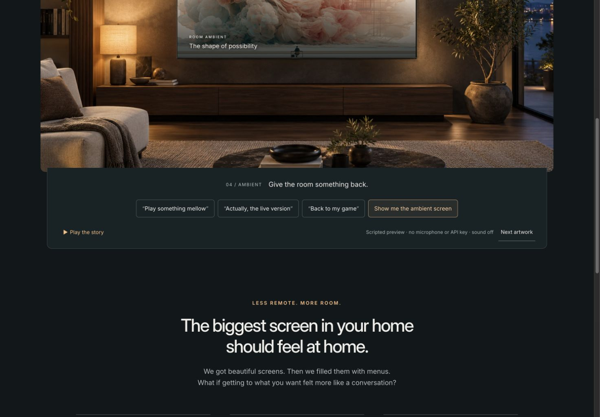

# Smart TV, for real tho

A personal voice interface and ambient art screen for an LG TV and Xbox, with native apps and a local controller.

**[Try the interactive room](https://smart-tv-for-real-tho.transitivebullsh.it/#experience)**



The interactive room is a scripted, browser-only preview. No hardware, account, microphone or API key required.

## Try it locally

Requires Node.js 24+ and pnpm 12.5.1.

```sh
pnpm install
pnpm demo
```

Open the printed URL, normally `http://127.0.0.1:3215/`. `pnpm build:demo` produces the static website in `build/site/`.

## Use your own TV

This is an **experimental personal project**. Spoken YouTube playback, Xbox control, a transparent overlay and automatic ambient art have worked on the owner's setup: **LG 86UA8450PSA, webOS 25, firmware 33.31.61; Xbox Series X; a Mac controller**. Other hardware and independent installation are unverified.

Install [uv](https://docs.astral.sh/uv/getting-started/installation/), then:

```sh
pnpm install
pnpm bridge:sync
pnpm setup:check
pnpm dev
```

Open the printed URL. In Room setup, pair the LG using its IPv4 address and accept the TV prompt; discover and save your own app/input mappings. Link native YouTube through **Settings → Link with TV code**. Optional Xbox setup uses Remote features, Microsoft sign-in and your installed games.

Voice needs your own OpenAI key; public YouTube search needs a YouTube Data API v3 key. Enter keys in local setup or an ignored `.env` based on [`.env.example`](.env.example). Use laptop microphone/speakers and push-to-talk. Xbox, voice and image uploads are optional.

Keep the controller running on the same LAN. Ordinary controls need no Developer Mode; the TV overlay and ambient apps do. See [installation and renewal](docs/distribution.md), [TV app packaging](docs/ambient-screensaver.md#rebuild-and-package), and [connection recovery](docs/runbook.md#recovery). Pairings and credentials stay in ignored `.local/` and `.env` files.

The local app starts in **Live mode** and reports unavailable hardware. Simulation must be selected explicitly. The public room demo never connects to your devices.

## Limits and development

The current Ember overlay still needs a sustained combined voice/source check. Cold-start, interruption/recovery and final ambient recovery checks remain open; short native samples are not a reliability guarantee. Automatic ambient entry needs an awake controller and valid TV Developer Mode. No LG Store release or TV-microphone integration is provided.

Run `pnpm test`, `pnpm build` and `pnpm build:demo` for local checks. Start with the [architecture/source map](docs/implementation-plan.md#task-to-source-map); see [dated hardware evidence](docs/implementation-status.md#evidence-index) and the [launch checklist](docs/launch-plan.md) for scope and remaining work.

[MIT](license) for code; [artwork terms and provenance](web/demo/assets/README.md) are separate.
